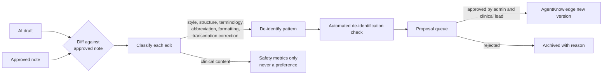

# AuraNoteTaker Pro: Agent Knowledge and learning

Status: draft v0.1, 20 October 2026. Implementation in Phase 5. Safety rules in [clinical-safety.md](clinical-safety.md) take precedence.

## 1. The separation

| A. Patient clinical data | B. Agent Knowledge |
|---|---|
| Transcripts, nurse notes, drafts, findings, approved notes | How Aura likes notes written: structure, phrasing, terminology, abbreviations, vocabulary, documentation rules |
| Patient-identifiable, special category | Contains no patient-identifiable information |
| Lives in the clinical store (and Dentally) under retention policy | Lives in the `AgentKnowledge` entity, versioned and approval-gated; optional Google Drive mirror |
| Used to write *this* patient's note | Used to shape *every* note's style |

There is no second patient-record database. Agent Knowledge never contains a transcript, a patient note, or an example derived from one unless it has been rewritten as a synthetic example and approved.

## 2. What counts as Agent Knowledge

| Kind | Example | Scope |
|---|---|---|
| Template guidance | "For composite bonding, record shade per tooth and the bonding system" | GLOBAL or CLINIC |
| Style | "Write 'Patient advised' rather than 'Pt told'" | CLINIC or CLINICIAN |
| Structure | Section order for a Halo Veneer fit note | CLINIC |
| Terminology and abbreviations | "LA" for local anaesthetic; Aura's preferred material names | CLINIC |
| Vocabulary hints | Product names (bonding systems, composites, implant systems) for speech-to-text and validation | GLOBAL or CLINIC |
| Transcription corrections | Commonly mis-heard term and its correction | CLINIC |
| Documentation rules | "If a radiograph is mentioned, a report is required; otherwise flag MISSING" | CLINIC |
| Synthetic examples | Clinician-written example notes with invented details | CLINIC |

Never Agent Knowledge: anything that states a clinical fact about a patient, anything that would cause the generator to assert something without a source, and any rule of the form "always include X" where X is a clinical event.

## 3. Seed knowledge

- **Aura's clinical note template library** (April 2026): 97 templates in 14 categories, Dentally native format, Palmer notation, local anaesthetic fields on every clinical template, Halo Veneers labelled as porcelain veneers made by Halo Dental Lab, brand-generic clear aligner templates. These become the first `Template` versions, mapped to the spec's 21 note types, after clinician review.
- A UK dental vocabulary list (materials, local anaesthetics, implant components, laboratory terms) for speech-to-text hints and validation.
- Notation rules for Aura's notation: quadrant and number, for example UR1 (D5), with spoken forms ("upper right one") accepted and tooth numbers such as 11 or 8 flagged for checking.

## 4. Learning loop



1. **Diff.** After approval, compare the AI draft with the approved note statement by statement.
2. **Classify.** Each edit is STYLE, STRUCTURE, TERMINOLOGY, ABBREVIATION, FORMATTING, TRANSCRIPTION_CORRECTION, or CLINICAL_CONTENT. Adding, removing or changing a clinical fact is CLINICAL_CONTENT. Clinical edits feed safety monitoring (they show where drafts go wrong) and never become preferences.
3. **Generalise.** Repeated non-clinical edits (default threshold: three occurrences across at least two sessions) become a proposed pattern, phrased as a *conditional* rule. For the spec's example: "When the sources show options, risks, benefits and alternatives were discussed, phrase it as: 'Treatment options, risks, benefits and alternatives discussed. Patient understands and wishes to proceed.'" The condition is part of the rule, so the phrasing can never appear without the supporting discussion.
4. **De-identify.** Proposals are stored as patterns, not excerpts. Automated checks remove or reject names, dates, ages, phone numbers, addresses, NHS numbers, Dentally IDs and free-text fragments longer than a short phrase. A human confirms before approval.
5. **Approve.** A clinic administrator and the clinical lead approve or reject. Approval creates a new `AgentKnowledge` version. Nothing goes live without approval.
6. **Use.** Generation retrieves the active knowledge for the clinic, clinician and note type, and pins `knowledge_version` on the generated note.
7. **Roll back.** Any version can be retired; the previous one becomes active again.

Changes to documentation *rules* (not just phrasing) get a safety impact note and CSO review, because rules change what is flagged.

### Rejected AI suggestions

The spec lists rejected AI suggestions as feedback to capture. Two kinds are recorded as de-identified `AgentFeedback` (P5-02):

- **Draft statements the clinician deleted.** Classified like any other edit. A deleted clinical statement is CLINICAL_CONTENT: it counts towards safety monitoring (the generator said something the clinician would not sign) and never becomes a preference. A deleted non-clinical phrase can become a style proposal ("do not write 'Patient happy'").
- **Safety findings the reviewer dismissed**, with the reason given. These go to the proposal queue as evidence that a check may be too sensitive. A dismissal never switches a check off or lowers its severity by itself: changing a safety rule needs the clinical lead's approval and a CSO review, like any other rule change.

## 5. Google Drive

Google Drive is a convenient place for humans to author and read templates and vocabulary. It is not the source of truth, and it never holds patient-identifiable content.

```
AuraNoteTaker Pro/
  Agent Knowledge/
    Global/
    Templates/
    Dental Vocabulary/
    Clinical Rules/
    Clinician Preferences/
    Approved Examples/        synthetic, clinician-written examples only
    Feedback/                 exported, de-identified proposal summaries
    Version History/
```

- Access restricted to a named group (clinical lead, practice manager, developers).
- **App to Drive:** approved versions are exported as read-only documents with version numbers.
- **Drive to app:** edits made in Drive become *proposals* in the app's approval queue. They never go live directly.
- Identifiable information never goes into the Agent Knowledge folders.

**Clinical history is separate (D2a).** Approved notes are also kept, for continuity between visits, in a different, locked-down shared drive in Aura's Google Workspace: `AuraNoteTaker Clinical History/`, one folder per Dentally patient ID, one file per approved note. It is the "separately controlled storage area" the spec allows for identifiable information kept for a legitimate purpose. It is not Agent Knowledge, it is never used to derive lessons directly, and only the app and named administrators can open it. Learning uses the de-identified draft-versus-approved differences captured at approval time.

## 6. Clinician preferences

Clinicians can see and edit their own active preferences (CLINICIAN scope), and propose changes. Preferences cannot override clinic documentation rules or safety principles; where they conflict, the clinic rule wins and the conflict is shown to the clinician.
