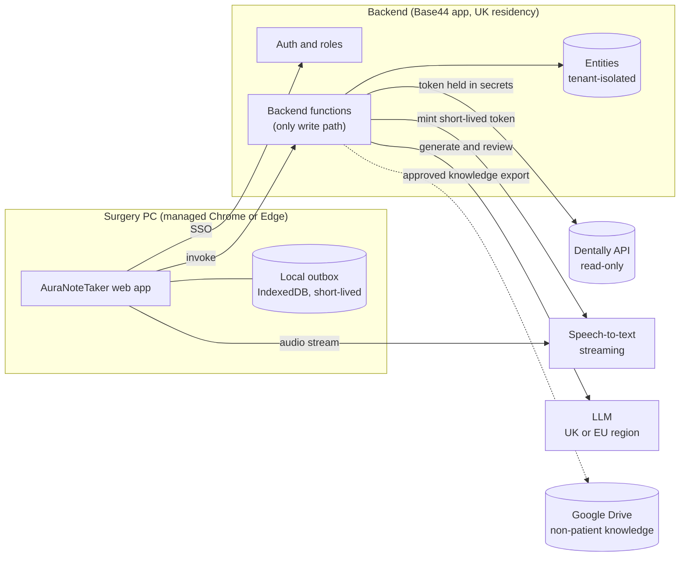
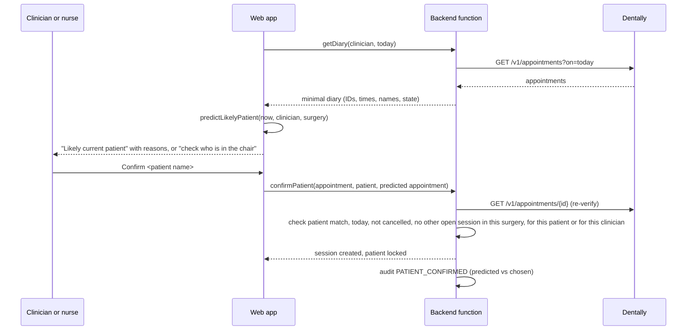
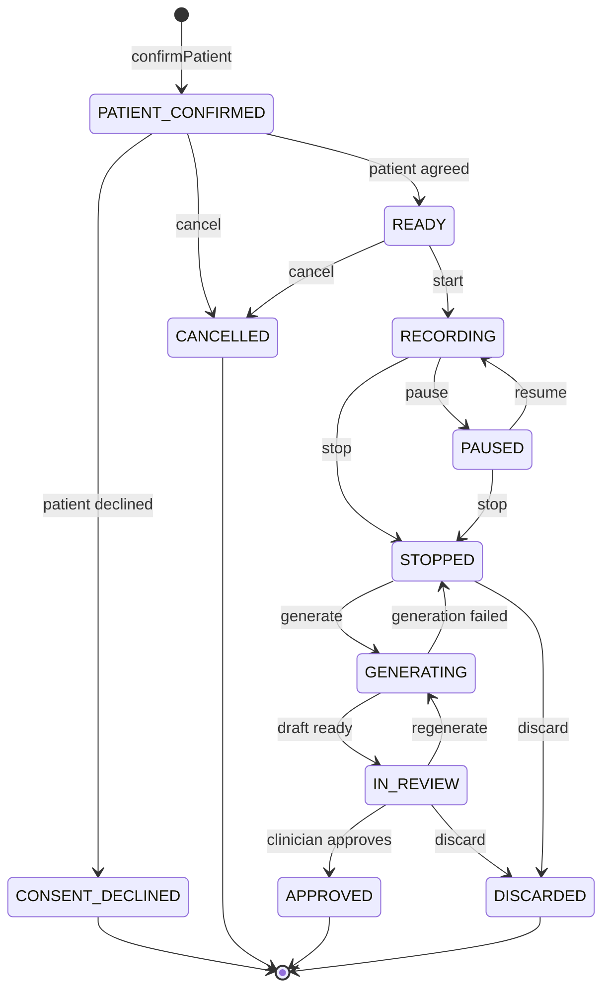

# AuraNoteTaker Pro: Architecture

Status: draft v0.1, 20 October 2026. Owner: Dr Hisham Saqib.
Items marked **DECISION NEEDED** are escalations. They are collected, with recommendations, in [roadmap.md](roadmap.md#decisions-needed).

---

## 1. What this system is

AuraNoteTaker Pro is an ambient dental scribe for the surgery computer. With the patient's permission it transcribes the appointment, combines the transcript with notes the nurse types, drafts a structured dental record for the clinician to review, edit and approve, and keeps a complete audit trail. A separate module audits clinical records for documentation completeness and consistency.

It is deliberately an administrative documentation tool. It never diagnoses, never recommends treatment, never decides on its own which patient is in the chair, and never writes to the clinical record without a named clinician's approval. Those limits are safety requirements. They also keep the product outside medical device regulation under the MHRA's July 2026 guidance on ambient voice technology (see [clinical-safety.md](clinical-safety.md#2-regulatory-position)).

## 2. What exists today (inspection on 20 October 2026)

| Area | Finding | Consequence |
|---|---|---|
| Repository | No existing AuraNoteTaker code anywhere reachable. The build session can push to GitHub repositories that are explicitly attached to it, but cannot create repositories. | Repo `auranotetaker-pro` must be created by Hisham and attached. All work so far is committed locally, ready to push. |
| Base44 | Seven existing Aura Base44 apps (AuraPortal, AuraFlo, AuraKPI, AuraMail, AuraPlans, HaloPortal, Aura Academy). AuraMail already syncs Dentally patients, treatment plan items and treatment/plan lookups, so a Dentally API credential already exists in Base44 secrets. No AuraNoteTaker app exists and no Base44 credentials are available to the build environment. | New Base44 apps are needed (staging and production). Reuse the pattern, not the credential: AuraNoteTaker gets its own least-privilege Dentally token. |
| Dentally | Public v1 REST API (`api.dentally.co`, sandbox `api.sandbox.dentally.co`). Appointments, patients, practitioners and related resources are readable. No public endpoint reads or writes clinical notes. Dentally lists Notes, Audit and Patient documents as unavailable through the API, with no timeline. The NexGen (v2) API is an early preview covering Sites and Patients only. | Phase 1 is fully supported. Phase 4 write-back and Phase 6 historical audit are blocked on Dentally. See [dentally-integration.md](dentally-integration.md). |
| Google Drive | Connector works. No existing AuraNoteTaker folders. | Phase 5 can create the controlled folder structure, for non-patient content only. |
| Secrets in the build environment | None for Dentally, Base44, speech-to-text or LLM providers. Only build-infrastructure tokens. | Phase 1 code is built and tested against a mock Dentally service and fictional demo data. Nothing has touched production data. |
| Existing clinical standards | Aura's clinical note template library: 97 templates in 14 categories, Dentally native format, **Palmer notation**, local anaesthetic fields on every clinical template (April 2026). | These templates seed Phase 3. Tooth notation becomes a clinic setting, because the spec says FDI and Aura's standard is Palmer. **DECISION NEEDED** (D5). |

## 3. System overview



Design principles:

1. **The browser never holds long-lived secrets.** Dentally, LLM and Google credentials live in backend secrets. The browser streams audio to the speech-to-text provider with a short-lived token minted for that session.
2. **Backend functions are the only write path for clinical, configuration and audit data.** Entity access rules deny direct client reads and writes on those entities. Functions enforce role, tenant, patient-lock and provenance rules, then write with the service role.
3. **Dentally is the system of record.** AuraNoteTaker stores Dentally identifiers, not copies of patient demographics. Names and dates of birth are fetched live for display and are never persisted.
4. **Every clinical text fragment carries provenance** (transcript segment, nurse note, appointment data, template, AI draft, clinician edit), so the review screen and safety checks can trace any statement back to its source.
5. **Runtime-agnostic core.** Prediction, session rules, Dentally parsing and server handlers are dependency-free TypeScript that runs in the browser, in Base44 functions (Deno) or in Node. This keeps the hosting decision in section 8 reversible.
6. **Fail safe, never silent.** When something is uncertain or broken the system stops and says so: ambiguous patient means an explicit choice, a transcription gap is shown as a gap, an unavailable Dentally means no new session rather than a guessed patient.

## 4. Components

### 4.1 Web app (`src/`)

React, TypeScript and Vite, desktop-first, large controls. Two modes:

- **Demo mode** (default for local development): a fictional diary and an in-memory backend that runs the real server handlers. A permanent banner makes it impossible to mistake for live data.
- **Connected mode**: Base44 authentication and backend functions.

Screens: sign in; clinician and surgery setup (remembered on the device, no patient data); main clinical screen (likely patient, confirm, change); scribe workspace (Phase 2); review (Phase 3); audit (Phase 6); administration.

The clinical app loads no third-party scripts, fonts, analytics or error trackers. Base44 keeps session tokens in `localStorage`, so cross-site scripting hardening (strict Content Security Policy, no inline script, no third-party code) is a primary control. The Base44 SDK's built-in analytics is switched off.

### 4.2 Domain core (`lib/core`)

- `prediction.ts`: the likely-current-patient engine (section 5.2).
- `session.ts`: the scribe session state machine, patient lock, permission rules and forgotten-stop detection.
- `audit.ts`: the audit event builder. Each action has an allowlist of metadata keys, so clinical free text cannot leak into audit records.
- `time.ts`: clinic time zone handling (Europe/London, safe across clock changes).
- Later phases add tooth notation (Phase 3), the provenance model and draft-to-final diff classification (Phase 5).

### 4.3 Dentally integration (`lib/dentally`)

A read-only client (only HTTP GET exists in the code, and a test enforces it), response validation that fails safe on unexpected data, capability flags that report unsupported operations honestly, and a mock service for demo mode and tests. Detail in [dentally-integration.md](dentally-integration.md).

### 4.4 Server handlers (`lib/server`) and Base44 functions (`base44/`)

Pure handlers with injected dependencies (clock, Dentally service, repositories, audit sink), wrapped by thin Base44 function entry points. Handlers re-verify everything the client claims. For example, confirming a patient re-fetches the appointment from Dentally and checks it really belongs to that patient, is today, and is not cancelled.

Because Base44 functions can only import code inside the `base44/` folder, `scripts/sync-base44-shared.mjs` copies `lib/` into `base44/shared/lib/`. CI fails if the copy drifts.

### 4.5 Speech-to-text (Phase 2)

An `SttProvider` interface: mint a session token, open a stream, send audio frames, receive interim and final segments, supply vocabulary hints, optional diarisation. Provider choice is **DECISION NEEDED** (section 9). Audio is not stored on the server by default.

### 4.6 Note generation and safety review (Phase 3)

Two independent model passes plus deterministic checks:

1. **Generate.** A template-guided structured draft in which every statement cites its sources (transcript segment IDs, nurse note lines, appointment fields). A statement without a citation cannot enter the draft. A template field with no supporting source becomes MISSING rather than being filled in.
2. **Review.** A separate model call with a different prompt re-reads the sources and the draft, labels each statement FACT, INFERENCE, MISSING INFORMATION or POSSIBLE CONTRADICTION, and raises findings (unsupported statements, nurse versus transcript conflicts, consent or risk discussions that were mentioned but not recorded).
3. **Deterministic validators** in code: tooth notation validity and consistency, laterality words versus tooth codes, local anaesthetic and medication names against a vocabulary, doses and batch numbers versus nurse notes.

The prompt version, model ID, template version and Agent Knowledge version are pinned on every generated note so any output can be reproduced and explained later.

### 4.7 Audit module (Phase 6)

Batch runs over clinical notes produce advisory findings with a reviewer workflow and a per-clinician dashboard. The data source is **DECISION NEEDED** because Dentally does not expose clinical notes through its API.

### 4.8 Agent Knowledge (Phase 5)

Versioned, approval-gated knowledge about style, structure, vocabulary and documentation rules, kept separate from patient data. See [agent-knowledge.md](agent-knowledge.md).

## 5. Key flows

### 5.1 Start of day

1. A staff member signs in with their own account (Microsoft or Google single sign-on through Base44). No shared logins.
2. They pick the clinician and the surgery. The choice is remembered on that PC (two IDs, no patient data).
3. The app loads today's diary for that clinician and refreshes it every minute while visible.

### 5.2 Likely patient and confirmation (Phase 1)



Engine rules (implemented in `lib/core/prediction.ts`, tested in `lib/core/prediction.test.ts`):

- Candidates are the selected clinician's appointments that have a patient and are not cancelled, did-not-attend or completed.
- **Tier 1**: Dentally shows the patient *In surgery*, or the current time is inside the scheduled slot.
- **Tier 2**: starts within 10 minutes, or the scheduled finish passed within the last 30 minutes and the appointment is not completed (overrun).
- One tier-1 candidate gives **LIKELY, HIGH** confidence (MEDIUM if the appointment is booked in a different surgery or Dentally returned an unrecognised state). One tier-2 candidate gives **LIKELY, MEDIUM**.
- Two or more candidates in the top tier give **AMBIGUOUS**: nothing is preselected and the user must pick the patient in the chair. Double bookings and overruns land here.
- No candidates gives **NONE**, with the next appointment offered.

The suggestion is never acted on by itself. If the suggestion changes while it is on screen (for example at the turn of an appointment slot), the confirm buttons are disabled for 1.5 seconds so a tap meant for one patient cannot land on another.

### 5.3 Scribe session (Phase 2)



The confirmed patient is fixed when the session is created. No transition changes it. The only way to change it is an explicit, reasoned, audited reassignment, which is refused while recording (pause first) and after approval. If the patient declines the AI scribe, the session ends with no recording and no AI processing of any of that appointment's data.

### 5.4 Generate, review, approve (Phases 3 and 4)

Stop, then generate (with the inputs snapshotted and hashed so late nurse edits are detected), then the review screen shows transcript, nurse notes, the draft with provenance, and the safety findings side by side. High-severity findings must each be resolved before approval. Approval records the approving clinician. Delivery to Dentally depends on what Dentally allows (section 2): by default the approved note is exported in a Dentally-ready format and the clinician confirms it was entered.

### 5.5 After approval

Reset clears the workspace, keeps nothing patient-identifiable on screen, and offers the next Dentally appointment for that clinician.

## 6. Background recording: what is and is not reliable

Facts that shape the design:

- Chrome intensively throttles *timers* (`setTimeout`/`setInterval` chains) in pages that have been hidden for more than 5 minutes, silent for 30 seconds and are not using WebRTC, running them only once a minute. Google's advice is to replace timer polling with event-driven APIs. Chrome's documentation does not say whether microphone capture on its own exempts a page ([Chrome timer throttling](https://developer.chrome.com/blog/timer-throttling-in-chrome-88/)).
- Under the Screen Wake Lock specification the lock is released when the page is hidden, so a web page cannot keep the PC awake. If the operating system sleeps, capture stops.
- Closing the tab, a browser crash, an operating system lock or sleep policy, a Bluetooth headset dropping out, or another application taking exclusive use of the microphone stop capture whatever the app does.

Design response:

- Capture runs in an AudioWorklet and uploads are driven by audio frames arriving, not by timers.
- A capture watchdog counts audio frames. Any gap longer than 3 seconds appears in the transcript as a visible gap marker and in the header status, never silently.
- Periodic tasks (diary refresh, heartbeats) tolerate one-minute delays while hidden and resynchronise on `visibilitychange`.
- Deployment requirements: managed Chrome or Edge with the app excluded from tab discarding or sleeping (Chrome `TabDiscardingExceptions`, Edge `SleepingTabsBlockedForUrls`, to be verified on Aura's machines), operating system sleep disabled during clinic hours, exclusive microphone mode off.
- Phase 2 includes a measured spike on Aura's actual surgery PCs with a recorded test matrix (see the Phase 2 issues). If browser capture is unreliable in any common surgery scenario, Phase 2b builds a lightweight desktop companion (system-level capture, sleep prevention, tray recording indicator) that streams to the same backend. The product makes no claim about background reliability until the spike results are recorded.

## 7. Patient identity safeguards

1. The prediction engine only suggests. Nothing is attached to a patient without an explicit confirm by a signed-in user.
2. Ambiguity is surfaced as a choice with no default.
3. The confirm button names the patient ("Confirm Oliver Bennett") and is briefly disabled when the suggestion changes.
4. The server re-verifies the appointment and patient with Dentally and refuses a second open session in the same surgery, for the same patient, or for the same clinician (who may have moved surgery).
5. The session's patient is locked at creation. Diary refreshes, clock changes and new predictions never touch an existing session.
6. Reassignment is a separate, reasoned, audited action, refused while recording and after approval.
7. A recording that runs past its appointment into the next patient's slot raises a prominent warning. It never switches patient automatically.
8. Every confirmation records what was predicted and what was chosen, so near misses are measurable.

## 8. Hosting and data residency: DECISION NEEDED (D2)

What Base44's documentation says (October 2026):

- Servers are in the United States by default. EU or UK data clusters are available on Enterprise (one section also lists Business). Residency controls where data is **stored**, not where it is **processed**.
- SOC 2 Type II and ISO 27001. A Data Processing Agreement is available.
- On every plan except Enterprise, app data **can be used to train AI models**.
- Session tokens are kept in `localStorage`; HttpOnly cookies are not available. Session timeout is not configurable.
- Workspace audit logs and customer-managed encryption keys are Enterprise features.
- The code-first backend service and CLI are in beta.
- Users can update custom fields on their own user record (`auth.updateMe`), so roles and clinic membership must never be read from the user record.

Sources: [Base44 privacy and security](https://docs.base44.com/Community-and-support/Privacy-and-security), [Base44 security overview](https://docs.base44.com/Setting-up-your-app/security-overview.md), [Base44 backend introduction](https://docs.base44.com/developers/backend/overview/introduction).

| Option | What lives where | For | Against |
|---|---|---|---|
| **A. Base44 Enterprise, UK cluster** | Everything in Base44 | Matches the spec and Aura's existing apps; built-in auth, functions, access rules; fastest to build | Enterprise cost; beta backend; processing location not guaranteed by residency; token storage model |
| **B. Split** | Identity, roles, configuration and templates in Base44. Transcripts, nurse notes, drafts, approved notes and findings in AWS London (eu-west-2), alongside the LLM | UK storage and processing for all clinical content; one AWS agreement covers storage and AI | Two backends to secure and connect; more engineering |
| **C. AWS London only** | Everything in AWS eu-west-2 | Strongest control (KMS keys, CloudTrail, S3 Object Lock for audit) | Most engineering and operations; diverges from Aura's Base44 ecosystem |

**Recommendation:** Option A, provided Base44 confirms in writing: UK storage for app data, no AI training on the workspace, the sub-processor list with processing locations, a DPA that covers special category health data, backup retention, and breach notification terms. If any of those cannot be confirmed, Option B. **Not acceptable under any option:** patient data on a non-Enterprise Base44 plan.

Needed by: before any production Dentally data reaches Base44 (the Phase 1 pilot) and before Phase 2 stores the first transcript. Development continues meanwhile on demo data and the Dentally sandbox.

## 9. AI providers: DECISION NEEDED (D3)

**LLM.** Claude through Amazon Bedrock, pinned to one region. London (eu-west-2) offers in-region inference for Claude Opus 4.6 and Sonnet 4.6; newer models are only available there through cross-region routing. Ireland and Stockholm offer in-region routing for newer models through Bedrock's Mantle endpoint. Single-region use is enforced with application inference profiles and an IAM `aws:RequestedRegion` condition, and verified in CloudTrail ([AWS: single-region Claude on Bedrock](https://aws.amazon.com/blogs/machine-learning/enforcing-data-residency-with-single-region-claude-code-on-amazon-bedrock)). Recommendation: Sonnet 4.6 in London for UK-only processing, revisited when newer models gain London in-region support. Confirm no-training and retention terms in the AWS agreement.

**Speech-to-text.** A bake-off between two shortlisted providers:

- Speechmatics: UK company, medical English model, real-time streaming with sub-second finals, custom dictionary with phonetic hints, on-premises option ([comparison](https://www.speechmatics.com/how-we-compare/aws-alternative)).
- AWS Transcribe, general en-GB model (Transcribe Medical and HealthScribe support US English only), which would keep all AI processing under one AWS agreement.

Criteria: word error rate on dental vocabulary, Palmer and FDI notation and drug names using staged or consented recordings; UK or EU processing; no training on audio; zero retention; latency; diarisation; cost.

## 10. Multi-clinic design

Aura is the first tenant, but every entity carries `clinic_id` and every function resolves the caller's clinic from their staff profile, never from the request. Integrations and secrets are per clinic (secret names include the clinic key). Agent Knowledge is scoped GLOBAL, CLINIC or CLINICIAN, and only de-identified, approved items can be GLOBAL. Tests in Phase 7 attempt cross-tenant access through every function.

## 11. Repository layout

```
auranotetaker-pro/
  docs/                    architecture and governance documents
  lib/
    core/                  prediction, session lock, audit builder, time (no dependencies)
    dentally/              read-only client, validation, capabilities, mock service
    server/                backend handlers with injected dependencies, in-memory stores
  base44/
    config.jsonc           Base44 project configuration
    entities/              entity schemas with deny-by-default access rules
    functions/             thin function entry points (Deno)
    shared/adapters/       Base44-specific repositories and context resolution
    shared/lib/            generated copy of lib/ (do not edit)
  src/                     React web app (demo and connected modes)
  scripts/                 shared-code sync, GitHub backlog creation
  .github/                 CI, pull request template
```

## 12. Decision log

| # | Decision | Why | Revisit if |
|---|---|---|---|
| A1 | TypeScript throughout; React and Vite for the web app | One language for browser, functions and tests; Base44 SDK is TypeScript | Desktop companion needs native code |
| A2 | Dependency-free domain core in `lib/` | Runs in Deno and Node unchanged; small supply-chain surface for safety-critical code | Never for prediction and session logic |
| A3 | Backend functions are the only path to clinical, config and audit entities | Base44 access rules cannot express role-plus-tenant rules safely, and user records are self-editable | Hosting moves off Base44 |
| A4 | Store Dentally IDs, fetch demographics live | Data minimisation; Dentally stays the record | Offline identity policy (D9) needs a cached identifier |
| A5 | Read-only Dentally client; no use of appointment notes or metadata as a stand-in for clinical notes | Appointment notes are diary notes visible to reception, not the clinical record | Dentally provides a notes API |
| A6 | Ambiguous prediction means explicit choice with no default | Wrong-patient risk outweighs one extra tap | Never |
| A7 | Patient declines means no recording and no AI processing for that appointment | Most conservative reading of permission | D7 changes it |
| A8 | Demo mode is the local default and permanently bannered | Developers never need production data | Never |
| A9 | Audio not stored server-side by default | Data minimisation; transcript plus nurse notes are the inputs | Failure-recovery testing shows a short buffer is needed (then 24 hours maximum) |
| A10 | Tooth notation stored canonically, displayed in the clinic's notation | Aura uses Palmer; speech arrives in mixed forms; validation needs one canonical form | D5 |
