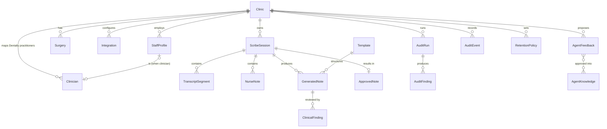

# AuraNoteTaker Pro: Data model

Status: draft v0.1, 20 October 2026. Companion to [architecture.md](architecture.md) and [security-and-privacy.md](security-and-privacy.md).

## 1. Principles

1. **Tenant on every row.** Every entity except GLOBAL Agent Knowledge and Templates carries `clinic_id`. Functions resolve the caller's clinic from their `StaffProfile`, never from request input.
2. **Identifiers, not copies.** Patients are referenced by `dentally_patient_id`. AuraNoteTaker never stores patient names, dates of birth, addresses, phone numbers or NHS numbers. The appointment details captured at confirmation are a minimal snapshot needed to make the audit trail meaningful.
3. **Functions are the only write path** for clinical, configuration and audit entities. Entity access rules deny direct client access to them (section 5).
4. **Append-only audit.** `AuditEvent` rows are never updated or deleted, except by the retention job for expired rows. Phase 7 adds hash chaining for tamper evidence.
5. **Provenance on clinical text.** Every statement in a generated note records which sources support it. Nurse notes record their author.
6. **Versioned and reproducible.** Generated notes pin template, prompt, model and knowledge versions plus a digest of the inputs used.
7. **Retention by data class.** Every clinical entity belongs to a retention class governed by `RetentionPolicy` (defaults proposed in [security-and-privacy.md](security-and-privacy.md#7-retention)). Nothing is retained indefinitely by default.

Base44 adds `id`, `created_date`, `updated_date` and `created_by` to every entity. They are not repeated below.

## 2. Entity overview

| Entity | Phase | Retention class | Contains patient-identifiable content? |
|---|---|---|---|
| Clinic | 1 | Config | No |
| StaffProfile | 1 | Config | No (staff data) |
| Clinician | 1 | Config | No (staff data) |
| Surgery | 1 | Config | No |
| Integration | 1 | Config | No (secret *names* only) |
| ScribeSession | 1 | Session | Dentally patient and appointment IDs only |
| AuditEvent | 1 | Audit | Dentally IDs only, never clinical text |
| PatientReference | 2 | Config | Dentally patient ID plus AI-scribe preference |
| TranscriptSegment | 2 | Transcript | **Yes** |
| NurseNote | 2 | Transcript | **Yes** |
| GeneratedNote | 3 | Draft | **Yes** |
| ClinicalFinding | 3 | Draft | **Yes** (references and explanations) |
| Template | 3 | Config | No |
| ApprovedNote | 3/4 | Clinical record | **Yes** |
| AgentFeedback | 5 | Knowledge | No (de-identified patterns only) |
| AgentKnowledge | 5 | Knowledge | No |
| AuditRun | 6 | Audit | No |
| AuditFinding | 6 | Audit finding | **Yes** (note excerpts and references) |
| RetentionPolicy | 7 | Config | No |

`AppointmentReference` from the spec is embedded in `ScribeSession.appointment` rather than stored as its own entity, because an appointment reference only exists in the context of a session and embedding avoids a second write in the confirmation path.

## 3. Phase 1 entities (schemas in `base44/entities/`)

### Clinic
| Field | Type | Notes |
|---|---|---|
| name | string | |
| slug | string | Short key used in secret names, e.g. `aura` |
| time_zone | string | IANA zone, default `Europe/London` |
| tooth_notation | enum `PALMER`, `FDI` | Output notation for notes. Aura default `PALMER` pending D5 |
| dentally_site_id | string, nullable | Restricts diary queries to the clinic's site |
| status | enum `ACTIVE`, `SUSPENDED` | |
| settings | object | `early_start_minutes` (10), `overrun_minutes` (30), `inactivity_lock_minutes` (10), `writeback_mode` (`NONE` until D1) |

### StaffProfile
Links a Base44 user account to a clinic and an application role. This is the only source of truth for authorisation.

| Field | Type | Notes |
|---|---|---|
| user_email | string (email) | Matches the Base44 user's email, which users cannot change themselves |
| clinic_id | string | |
| app_roles | array of enum | One or more of `SUPER_ADMIN`, `CLINIC_ADMIN`, `DENTIST`, `THERAPIST`, `HYGIENIST`, `NURSE`, `AUDITOR` (a dentist who manages the practice holds both `DENTIST` and `CLINIC_ADMIN`) |
| clinician_id | string, nullable | Set when this person is also a Dentally practitioner |
| display_name | string | |
| active | boolean | Inactive profiles are refused by every function |

### Clinician
Maps a Dentally practitioner. Practitioners exist here even if they never sign in.

| Field | Type | Notes |
|---|---|---|
| clinic_id | string | |
| dentally_practitioner_id | string | What appointments reference as `practitioner_id` |
| dentally_user_id | string, nullable | AuraPortal used `user.id`; verify which one appointments carry (issue P1-03) |
| display_name | string | |
| clinician_type | enum `DENTIST`, `THERAPIST`, `HYGIENIST`, `OTHER` | |
| active | boolean | |

### Surgery
| Field | Type | Notes |
|---|---|---|
| clinic_id | string | |
| name | string | e.g. "Surgery 2" |
| dentally_room_id | string, nullable | Used by the prediction engine when available |
| active | boolean | |

### Integration
| Field | Type | Notes |
|---|---|---|
| clinic_id | string | |
| kind | enum `DENTALLY`, `STT`, `LLM`, `GOOGLE_DRIVE` | |
| environment | enum `SANDBOX`, `PRODUCTION` | |
| status | enum `NOT_CONFIGURED`, `ACTIVE`, `DEGRADED`, `DISABLED` | |
| secret_name | string | Name of the backend secret. The value is never stored in an entity |
| config | object | Non-secret settings: base URL, site ID, region, model ID |
| capabilities | object | Last detected capabilities, e.g. `{ clinicalNotesWrite: false }` |
| last_checked_at | date-time | |
| last_error_code | string, nullable | Codes only, no response bodies |

### ScribeSession
| Field | Type | Notes |
|---|---|---|
| session_id | string | Generated by the confirming function |
| clinic_id | string | |
| status | enum | See the state machine in [architecture.md](architecture.md#53-scribe-session-phase-2) |
| dentally_patient_id | string | **Locked at creation.** Changed only by an audited reassignment |
| dentally_appointment_id | string | Also kept at the top level so the sessions for an appointment can be found (today's outcomes, earlier declines) |
| appointment | object | Snapshot: `dentally_appointment_id`, `practitioner_id`, `room_id`, `start_time`, `finish_time`, `reason`, `state_at_confirmation` |
| clinician_id | string | Dentally practitioner ID of the treating clinician |
| surgery_id | string, nullable | |
| confirmation | object | `method` (`CONFIRMED_SUGGESTION`, `CHOSE_ALTERNATIVE`, `RESOLVED_AMBIGUITY`, `CHOSE_FROM_DIARY`), `predicted_appointment_id`, `matched_prediction`, `confirmed_by_email`, `confirmed_at` |
| consent | object | `status` (`PENDING`, `GIVEN`, `DECLINED`), `recorded_by_email`, `recorded_at` |
| reassignments | array of objects | `from_patient_id`, `to_patient_id`, `by_email`, `at`, `reason` |
| status_history | array of objects | `status`, `at`, `by_email` |
| recording_started_at, recording_stopped_at | date-time | Phase 2 |
| client_device_id | string | Random per-browser ID, for crossover detection |
| version | integer | Optimistic concurrency. Every update must supply the version it read |

### AuditEvent
| Field | Type | Notes |
|---|---|---|
| clinic_id | string | |
| occurred_at | date-time | Server time |
| actor_email | string | `system` for automatic actions (closing an abandoned session, resolving simultaneous confirmations) |
| actor_roles | array of strings | The actor's roles at the time |
| action | enum | Phase 1: `DIARY_VIEWED`, `PATIENT_VIEWED`, `PATIENT_CONFIRMED`, `CONSENT_RECORDED`, `PATIENT_REASSIGNED`, `SESSION_CANCELLED`, `SESSION_STATUS_CHANGED`, `INTEGRATION_CHECKED`, `ACCESS_DENIED` |
| session_id | string, nullable | |
| dentally_patient_id, dentally_appointment_id | string, nullable | |
| details | object | Only keys allowlisted for the action (enforced in `lib/core/audit.ts`). Never names, dates of birth or clinical text |
| client | object | `device_id`, `app_version` |
| dedupe_key | string, nullable | Lets the server record repeated views once per window, for example `DIARY:<clinician>:<date>` |
| prev_hash, hash | string | Phase 7 tamper evidence |

Optional fields are left out of a stored row rather than written as `null`. Detail values are type-checked as well as allowlisted: identifiers, codes, dates, counts and booleans only.

## 4. Later-phase entities

These are specified now so earlier phases do not paint later ones into a corner. Schemas are created in the phase that introduces them.

**PatientReference** (Phase 2): `clinic_id`, `dentally_patient_id`, `ai_scribe_preference` (`ASK_EACH_TIME`, `STANDING_DECLINE`), `preference_recorded_by_email`, `preference_recorded_at`. Lets a patient's standing refusal be honoured without asking every visit. No demographics.

**TranscriptSegment** (Phase 2): `clinic_id`, `session_id`, `seq` (integer, gap-free per session), `start_offset_ms`, `end_offset_ms`, `text`, `speaker` (diarisation label or null), `provider`, `provider_segment_id`, `is_final`, `confidence`, `kind` (`SPEECH`, `GAP`), `gap_reason` (`NETWORK`, `MIC_LOST`, `PAUSED`, `CAPTURE_STALLED`), `received_at`. Uniqueness on (`session_id`, `seq`) makes outbox replays idempotent.

**NurseNote** (Phase 2): `clinic_id`, `session_id`, `author_email`, `content`, `revision` (integer), `client_saved_at`, `server_saved_at`, `final` (boolean, set at stop). Each save is version-checked; a conflicting save is kept as a separate revision and surfaced, never overwritten.

**GeneratedNote** (Phase 3): `clinic_id`, `session_id`, `attempt`, `note_type`, `template_id`, `template_version`, `model_id`, `prompt_version`, `knowledge_version`, `input_digest` (hash of the exact transcript, nurse note revision and appointment snapshot used), `sections` (array of `{ key, title, statements: [{ id, text, label: FACT|INFERENCE, provenance: [{ source: TRANSCRIPT|NURSE|APPOINTMENT|DENTALLY|TEMPLATE, ref }] }] }`), `missing_fields`, `status` (`DRAFT`, `SUPERSEDED`, `APPROVED`, `DISCARDED`), `generated_at`.

**ClinicalFinding** (Phase 3): `clinic_id`, `session_id`, `generated_note_id`, `statement_id` (nullable), `label` (`FACT`, `INFERENCE`, `MISSING_INFORMATION`, `POSSIBLE_CONTRADICTION`), `category` (`UNSUPPORTED`, `MISSING`, `CONTRADICTION`, `TOOTH_NOTATION`, `LATERALITY`, `MEDICATION`, `MATERIAL`, `NURSE_TRANSCRIPT_CONFLICT`, `CONSENT`, `RISKS`, `MEDICAL_HISTORY`, `RADIOGRAPH`), `severity` (`HIGH`, `MEDIUM`, `LOW`), `evidence` (source references), `explanation`, `source` (`AI_REVIEW`, `RULE`), `resolution` (`UNRESOLVED`, `ACCEPTED`, `REJECTED`, `EDITED`), `resolved_by_email`, `resolved_at`, `resolution_note`.

**ApprovedNote** (Phases 3 and 4): `clinic_id`, `session_id`, `generated_note_id`, `final_text`, `final_sections`, `approved_by_email`, `approver_clinician_id`, `approved_at`, `content_hash`, `edit_summary` (statement counts added, removed, changed), `delivery` (`mode`: `NONE`, `EXPORT`, `API`; `status`: `NOT_SENT`, `EXPORTED`, `ENTRY_CONFIRMED`, `SENT`, `FAILED`; `idempotency_key`; `dentally_reference`; `last_attempt_at`; `response_code`), `addendum_of` (corrections are new addenda, never edits). Immutable once approved.

**Template** (Phase 3): `scope` (`GLOBAL`, `CLINIC`), `clinic_id`, `note_type` (the 21 types in the spec), `name`, `version`, `sections` (`{ key, title, required, guidance, field_type }`), `status` (`DRAFT`, `ACTIVE`, `RETIRED`), `approved_by_email`, `approved_at`, `source` (`AURA_LIBRARY_2026_04`, `CUSTOM`).

**AuditRun** (Phase 6): `clinic_id`, `requested_by_email`, `filters` (clinician, date range, treatment type, patient, severity), `data_source` (`APPROVED_NOTES`, `DENTALLY_EXPORT`, `DENTALLY_API` once available), `model_id`, `prompt_version`, `status`, `counts`, `started_at`, `finished_at`.

**AuditFinding** (Phase 6): `clinic_id`, `run_id`, `clinician_id`, `dentally_patient_id`, `dentally_appointment_id`, `note_ref`, `note_date`, `issue_type`, `severity`, `explanation`, `context_refs`, `reviewer_status` (`UNREVIEWED`, `ACCEPTED_FINDING`, `FALSE_POSITIVE`, `ACTION_REQUIRED`, `REVIEWED`), `reviewer_email`, `reviewed_at`, `reviewer_comment`. Always presented as advisory.

**AgentFeedback** (Phase 5): `clinic_id`, `scope` (`CLINIC`, `CLINICIAN`), `clinician_id`, `note_type`, `category` (`STYLE`, `STRUCTURE`, `TERMINOLOGY`, `TRANSCRIPTION_CORRECTION`, `ABBREVIATION`, `FORMATTING`, `REJECTED_SUGGESTION`, `DISMISSED_FINDING`), `pattern_before`, `pattern_after` (both de-identified), `occurrences`, `status` (`PROPOSED`, `APPROVED`, `REJECTED`), `reviewed_by_email`, `reviewed_at`, `deid_check` (`automated_pass`, `human_checked_by`). Edits classified as clinical content never become feedback (see [agent-knowledge.md](agent-knowledge.md)).

**AgentKnowledge** (Phase 5): `scope` (`GLOBAL`, `CLINIC`, `CLINICIAN`), `clinic_id`, `clinician_id`, `kind` (`VOCABULARY`, `RULE`, `STYLE`, `ABBREVIATION`, `TEMPLATE_GUIDANCE`, `SYNTHETIC_EXAMPLE`), `key`, `content`, `version`, `status` (`DRAFT`, `ACTIVE`, `RETIRED`), `approved_by_email`, `approved_at`, `source_feedback_ids`, `drive_file_id`.

**RetentionPolicy** (Phase 7): `clinic_id`, `data_class`, `retain_days`, `action` (`DELETE`, `ANONYMISE`), `approved_by_email`, `effective_from`. Legal holds are recorded per session and suspend deletion.

## 5. Access rules

Base44 entity access rules support simple conditions (record field equals a user attribute, role equality). They cannot safely express "same clinic AND role in a set", and users can edit custom fields on their own user record. Therefore:

| Entity group | Direct client read | Direct client write | Access path |
|---|---|---|---|
| Clinical (sessions, transcripts, nurse notes, drafts, findings, approved notes) | Denied | Denied | Functions, after role, tenant and session-membership checks |
| Audit (events, runs, findings) | Denied | Denied | Functions for CLINIC_ADMIN and AUDITOR (and a clinician viewing their own findings) |
| Configuration (clinic, staff profiles, clinicians, surgeries, integrations, templates, retention) | Denied | Denied | Functions; admin functions for changes |
| StaffProfile (own) | Own row only (`data.user_email` equals `{{user.email}}`) | Denied | Lets the UI show the signed-in user's role |

Every entity file in `base44/entities/` sets these rules explicitly, because Base44 makes an entity readable and writable by everyone when no rules are defined.

## 6. Key invariants (tested)

- A `ScribeSession`'s `dentally_patient_id` changes only through the `REASSIGN_PATIENT` event, which requires a reason and is refused while recording and after approval. The state machine enforces this today. The function that offers reassignment, and writes the `PATIENT_REASSIGNED` audit event, arrives with P4-06; until then nothing can change a session's patient.
- At most one non-terminal session per surgery and per clinician, and one per patient. Two simultaneous confirmations leave exactly one session.
- A session never exists without its `PATIENT_CONFIRMED` audit event, which is written first.
- `START_RECORDING` requires consent `GIVEN`. Consent `DECLINED` is terminal, and confirming that appointment again needs an explicit acknowledgement.
- Consent can be recorded only by the person who confirmed the patient or the treating clinician, from the session's surgery, on the appointment's day.
- Terminal statuses (`CONSENT_DECLINED`, `CANCELLED`, `APPROVED`, `DISCARDED`) accept no further events. A session from an earlier day with nothing recorded is closed (`CANCELLED`, reason `EXPIRED`) when next found.
- Audit `details` contain only allowlisted keys with type-checked values for their action.
- Session updates require the version that was read, checked in the same write (`updateMany` on id and version), so two browsers cannot silently overwrite each other.
- A stored row that fails validation is an error, never read with defaults filled in.
